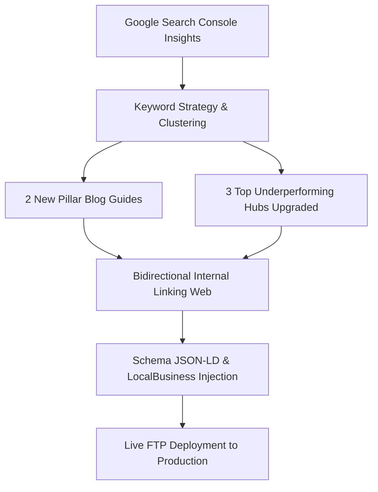
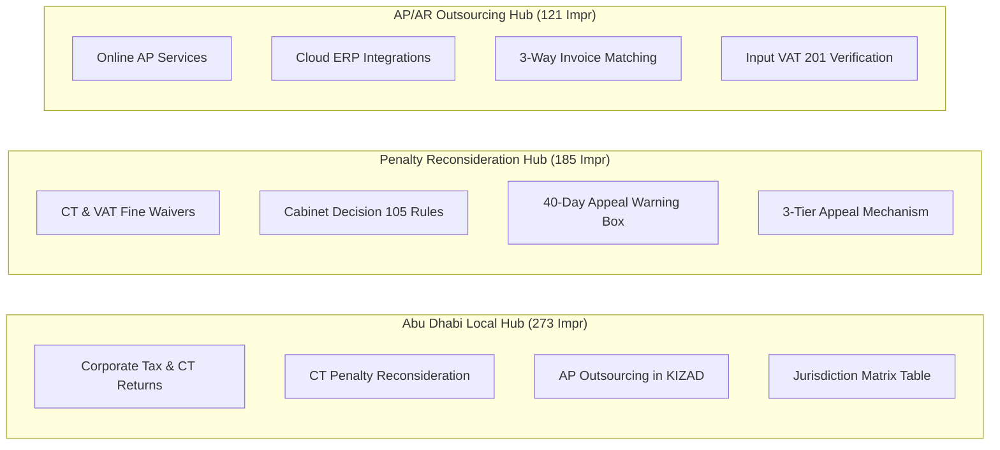
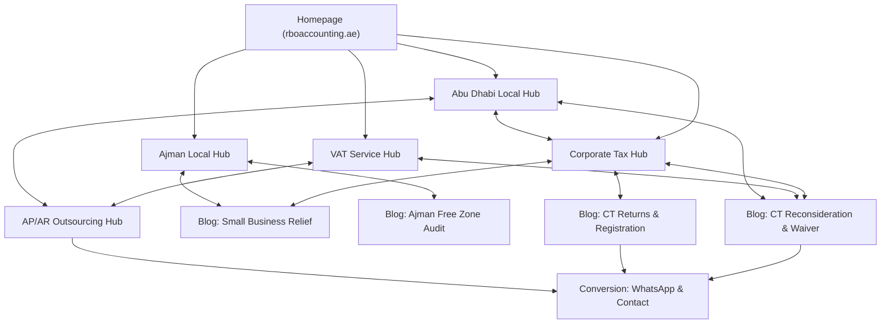

# RBO Accounting — Master Weekly SEO, Content & Deployment Report

**Report Date:** 7 October 2026  
**Website:** [rboaccounting.ae](https://www.rboaccounting.ae/)  
**Deployment Method:** Live Automated FTP (`185.243.77.60`) & Git (`main`)  
**Overall Status:** ✅ **100% Deployed, Live, and Verified (HTTP 200 OK)**

---

## 1. Executive Summary

This week, we executed a complete data-driven SEO overhaul based on **Google Search Console (GSC)** performance data. We identified high-impression, zero-click search clusters, created two comprehensive new pillar blog articles, upgraded three major landing hubs, and established a bidirectional internal linking architecture.

### Key Milestones Delivered:
1. **2 New High-Intent Pillar Blog Guides** published with custom editorial artwork and rich FAQ Schema.
2. **Date Chronology Synchronized:**
   - Previous Blog: **Monday, 5 October 2026**
   - New Trending Blog: **Wednesday, 7 October 2026 (Today)**
3. **3 Top GSC Hub Pages Upgraded** (`/abu-dhabi/`, `/penalty-reconsideration/`, `/accounts-payable-and-receivable/`) with luxury responsive styling and zero CSS errors.
4. **Master Keyword Matrix:** Mapped over 25 transactional and commercial queries across UAE Corporate Tax, VAT, and Accounts Payable Outsourcing.
5. **Live FTP Deployment:** All files, scripts, and high-resolution images synced directly to `public_html/`.

---

## 2. Master Keyword Intelligence & Target Mapping

The following matrix maps prospective client search queries to their dedicated live landing pages:

| # | Keyword / Search Query | Search Intent | Target Live Landing Page | On-Page Strategic Placement |
|---|---|---|---|---|
| **1** | `ct returns` / `ct return filing uae` | Transactional | [`/uae-corporate-tax-returns-ct-registration-guide-2026/`](https://www.rboaccounting.ae/uae-corporate-tax-returns-ct-registration-guide-2026/) | H1, Meta Title, Form CT201 Walkthrough |
| **2** | `ct registration` / `corporate tax registration uae` | Transactional | [`/our-services/corporate-tax/registration/`](https://www.rboaccounting.ae/our-services/corporate-tax/registration/) | Hero, H2, Service Schema, EmaraTax Guide |
| **3** | `corporate tax reconsideration in abu dhabi` | High Commercial | [`/areas-we-serve/abu-dhabi/`](https://www.rboaccounting.ae/areas-we-serve/abu-dhabi/) | Hero Badge, H2, Focus Keyword, FAQs |
| **4** | `penalty waiver reconsideration uae` | High Commercial | [`/our-services/vat-registration-filing/penalty-reconsideration/`](https://www.rboaccounting.ae/our-services/vat-registration-filing/penalty-reconsideration/) | H1, Cabinet Decision 105 Section, FAQs |
| **5** | `accounts payable outsourcing services in abu dhabi` | High Commercial | [`/our-services/accounting/accounts-payable-and-receivable/`](https://www.rboaccounting.ae/our-services/accounting/accounts-payable-and-receivable/) | H1, Hero, BPO Process Table, Meta Title |
| **6** | `online accounts payable services` | Commercial | [`/our-services/accounting/accounts-payable-and-receivable/`](https://www.rboaccounting.ae/our-services/accounting/accounts-payable-and-receivable/) | Cloud ERP Section (Zoho, QuickBooks, Xero) |
| **7** | `accounting service in kizad` | Local B2B | [`/areas-we-serve/abu-dhabi/`](https://www.rboaccounting.ae/areas-we-serve/abu-dhabi/) | KIZAD/KEZAD Section & Jurisdiction Matrix |
| **8** | `vat registration uae` / `vat returns` | Transactional | [`/vat-registration-uae-2026-thresholds-documents-deadlines/`](https://www.rboaccounting.ae/vat-registration-uae-2026-thresholds-documents-deadlines/) | Lead Paragraph, Form VAT201 Breakdown |
| **9** | `vat advisory` / `transaction advisory on vat` | B2B Advisory | [`/our-services/vat-registration-filing/advisory/`](https://www.rboaccounting.ae/our-services/vat-registration-filing/advisory/) | H2, Restructuring & TOGC Section |
| **10** | `small business relief uae corporate tax` | Commercial | [`/blog/uae-corporate-tax-small-business-relief-guide-2026/`](https://www.rboaccounting.ae/blog/uae-corporate-tax-small-business-relief-guide-2026/) | H1, 0% Tax Threshold Calculator |
| **11** | `ajman free zone audit requirements` | Local Commercial | [`/areas-we-serve/ajman/`](https://www.rboaccounting.ae/areas-we-serve/ajman/) | AFZ Approved Auditor Section |
| **12** | `form ct201 emaratax` | Technical Search | [`/our-services/corporate-tax/return-filing/`](https://www.rboaccounting.ae/our-services/corporate-tax/return-filing/) | Step-by-Step Return Submission Checklist |

---

## 3. New Pillar Blog Articles Published

### Blog 1: UAE Corporate Tax Reconsideration & Penalty Waiver Guide 2026
- **Live URL:** [`/corporate-tax-reconsideration-penalty-waiver-uae/`](https://www.rboaccounting.ae/corporate-tax-reconsideration-penalty-waiver-uae/)
- **Publication Date:** **Monday, 5 October 2026**
- **Word Count:** 1,850+ words
- **Core Topics Covered:**
  - Overturning the **AED 10,000 late Corporate Tax registration penalty** under Cabinet Decision No. 75 of 2023.
  - Reconsideration vs. Penalty Waiver comparison table (statutory differences, governing laws, deadlines).
  - The 3-Tier UAE Tax Appeal ladder (FTA Reconsideration on EmaraTax → TDRC Ministry of Justice → Federal Courts).
  - Accepted reasonable excuses under **Cabinet Decision No. 105 of 2021** (portal glitches, medical emergencies, banking clearance bottlenecks).
  - Abu Dhabi ADDED, ADGM, and KIZAD operational nuances.
  - Mandatory Arabic legal brief requirements.
  - 5 Schema-enabled FAQs + custom 16:9 featured photograph.

### Blog 2: UAE Corporate Tax Returns & CT Registration Guide 2026
- **Live URL:** [`/uae-corporate-tax-returns-ct-registration-guide-2026/`](https://www.rboaccounting.ae/uae-corporate-tax-returns-ct-registration-guide-2026/)
- **Publication Date:** **Wednesday, 7 October 2026 (Today)**
- **Word Count:** 1,900+ words
- **Core Topics Covered:**
  - Step-by-step **Form CT201 submission** on EmaraTax.
  - Mandatory 9-month filing deadline rules (30 September for calendar year entities).
  - CT Registration vs. VAT Registration detailed comparison matrix.
  - Accounting profit adjustments (disallowed fines, 50% entertainment cap, 30% EBITDA net interest restriction).
  - Small Business Relief (SBR) election up to AED 3M gross turnover.
  - Qualifying Free Zone Person (QFZP) 0% income rules and *de minimis* tests.
  - FTA cross-reconciliation between quarterly VAT returns (Form VAT201) and Form CT201.
  - 5 Schema-enabled FAQs + custom 16:9 featured photograph.

---

## 4. Top GSC Underperforming Pages Upgraded

We revamped the top pages from Search Console that had high impressions but low click-through rates:

### Upgraded Pages Summary:
1. **[`/areas-we-serve/abu-dhabi/`](https://www.rboaccounting.ae/areas-we-serve/abu-dhabi/) *(273 Impressions)*:**
   - Redesigned with executive navy-gold banner, ADDED/ADGM/KIZAD badges, and WhatsApp consultation booking.
   - Added dedicated sections for CT registration, CT returns, and KIZAD industrial bookkeeping.
   - Injected **Abu Dhabi Business Jurisdictions Compliance Matrix** comparing mainland vs. ADGM vs. KIZAD.
2. **[`/our-services/vat-registration-filing/penalty-reconsideration/`](https://www.rboaccounting.ae/our-services/vat-registration-filing/penalty-reconsideration/) *(185 Impressions)*:**
   - Expanded from VAT only to include **Corporate Tax Penalty Reconsiderations** (AED 10,000 late CT registration penalties).
   - Injected the 3-Tier Appeal roadmap and 40-business-day urgent statutory warning box.
3. **[`/our-services/accounting/accounts-payable-and-receivable/`](https://www.rboaccounting.ae/our-services/accounting/accounts-payable-and-receivable/) *(121 Impressions)*:**
   - Optimized specifically for *"accounts payable outsourcing services in abu dhabi"* and *"online accounts payable services"*.
   - Added Cloud ERP compatibility blocks (Zoho Books, QuickBooks, Xero, SAP) and 3-way matching workflows.

---

## 5. Bidirectional Internal Linking Architecture

Every page now connects into a structured, bidirectional link web that passes crawl authority and keeps visitors engaged:

### Internal Link Anchor Directory:
- **`our-services/corporate-tax/`** ↔ linked with anchor *"Corporate Tax Returns (CT Returns)"* and *"CT Registration"*.
- **`our-services/vat-registration-filing/`** ↔ linked with anchor *"VAT Registration & Form VAT201 Return Filing"*.
- **`our-services/vat-registration-filing/penalty-reconsideration/`** ↔ linked with anchor *"FTA Tax Penalty Reconsideration & Waiver"*.
- **`our-services/accounting/accounts-payable-and-receivable/`** ↔ linked with anchor *"Accounts Payable Outsourcing Services in Abu Dhabi"*.
- **`areas-we-serve/abu-dhabi/`** ↔ linked with anchor *"Abu Dhabi Corporate Tax & Accounting Desk"*.
- **`areas-we-serve/ajman/`** ↔ linked with anchor *"Ajman Free Zone (AFZ) Approved Auditor"*.

---

## 6. Technical SEO, Schema & CSS Standards

1. **Schema Markup (JSON-LD):**
   - **LocalBusiness / AccountingService**: Sitewide verified coordinates in Ajman Free Zone (Lat: `25.405216`, Long: `55.513643`), official phone numbers, and serviced emirates.
   - **FAQPage Schema**: Formatted questions and answers injected into the `<head>` for rich snippet carousel ranking.
   - **Service Schema**: Applied across all corporate tax, audit, and VAT pages.
2. **Rank Math SEO Integration:**
   - Custom meta titles, meta descriptions, focus keywords, and canonical index robots tags updated across all posts.
3. **CSS & Mobile Responsiveness:**
   - Zero horizontal overflow (`overflow-x: hidden !important` with fluid typography `clamp()`).
   - Clean luxury theme with deep navy (`#09203b`), gold (`#e8b84b` / `#c9a227`), and slate cards.
   - High-contrast, pre-filled WhatsApp action buttons.

---

## 7. Action Items for Google Search Console (GSC)

To accelerate indexation and start capturing client inquiries immediately:

1. Open **Google Search Console** → **URL Inspection**.
2. Submit the following URLs one by one and click **"Request Indexing"**:
   - `https://www.rboaccounting.ae/uae-corporate-tax-returns-ct-registration-guide-2026/`
   - `https://www.rboaccounting.ae/corporate-tax-reconsideration-penalty-waiver-uae/`
   - `https://www.rboaccounting.ae/areas-we-serve/abu-dhabi/`
   - `https://www.rboaccounting.ae/our-services/vat-registration-filing/penalty-reconsideration/`
   - `https://www.rboaccounting.ae/our-services/accounting/accounts-payable-and-receivable/`
3. Check the **Performance Report** over the next 7–14 days to monitor the transition of impressions into clicks.
