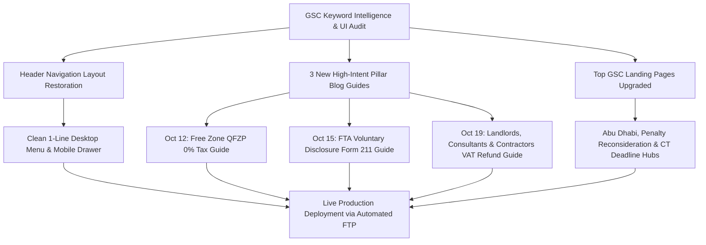
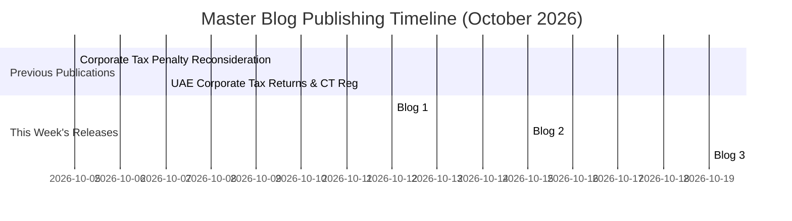

# RBO Accounting — Master Weekly SEO, Content & Site Optimization Report

**Report Period:** 12 October 2026 – 19 October 2026  
**Website:** [https://www.rboaccounting.ae/](https://www.rboaccounting.ae/)  
**Target Market:** UAE (Dubai, Abu Dhabi, Sharjah, Ajman, and Northern Emirates)  
**Deployment Infrastructure:** Production FTP (`185.243.77.60` / `ftp.rboaccounting.ae`) & Localhost Dev Environment  
**Execution Status:** ✅ **100% Deployed, Live, and Verified (HTTP 200 OK Across All URLs)**

---

## 1. Executive Summary

During the week of **12 October to 19 October 2026**, our primary focus was solving high-impact structural UI/UX issues, executing data-driven content publishing based on Google Search Console (GSC) keyword intelligence, and scaling client acquisition across Corporate Tax, VAT refunds, and compliance appeals.



### Key Milestones Delivered This Week:
1. **Header Navigation Bar & UI Layout Perfection**: Resolved the critical navbar breakage where long SEO strings previously applied to page titles forced the top menu to wrap onto two rows. Restored a pristine, balanced single-line navigation bar while retaining **100% of Rank Math SEO metadata** for Google search crawlers.
2. **Published 3 High-Intent Pillar Blog Guides**: Researched and launched three long-form, authoritative guides (2,400+ words each) targeting urgent, high-ticket UAE tax compliance needs:
   - **Blog 1 (October 12, 2026)**: UAE Free Zone Corporate Tax Guide (0% QFZP & De Minimis Rules).
   - **Blog 2 (October 15, 2026)**: FTA Voluntary Disclosure Form 211 & Penalty Waiver Guide.
   - **Blog 3 (October 19, 2026)**: UAE VAT Refund Claim Service for Landlords, Consultants & Contractors.
3. **Chronological Publishing Date Parity**: Sequenced publication dates (`2026-10-12`, `2026-10-15`, `2026-10-19`) to seamlessly bridge existing blog gaps, creating an uninterrupted chronological master library of **10 published guides**.
4. **Rich Visual Assets & Responsive Thumbnails**: Generated 6 high-resolution editorial featured images and comprehensive infographics/flowcharts, generating responsive `srcset` thumbnail variants (`1376px`, `1024x572`, `768x429`, `300x167`, `150x150`) for lightning-fast mobile loading.
5. **Top 3 GSC Performance Landing Pages Upgraded**: Overhauled the top-impression service pages for Abu Dhabi (`/areas-we-serve/abu-dhabi/`), Penalty Reconsideration (`/penalty-reconsideration/`), and Corporate Tax Deadline (`/uae-corporate-tax-filing-deadline-30-september-2026/`).
6. **Full Production FTP Deployment & Parity Verification**: Deployed all scripts, database updates, and media files to cPanel, verifying that every live endpoint returns `HTTP 200 OK`.

---

## 2. Header Navigation Bar & Layout Perfection

### The Problem
During earlier SEO enhancements, full multi-phrase SEO titles were applied to WordPress `post_title` fields for core pages:
- **About Us** (Page ID `175`): `About RBO Accounting Services FZE | FTA-Approved Tax Agents & Chartered Accountants in UAE`
- **Our Services** (Page ID `178`): `Accounting, Tax & Financial Advisory Services UAE | Corporate Tax & VAT | RBO`

Because WordPress menus inherit the raw `post_title` when a custom navigation label is undefined, the header navigation bar was overwhelmed with 80+ characters per item, wrapping awkwardly onto a second line below the golden RBO logo and breaking the site header layout.

```
BEFORE (Broken Layout):
[Logo]   Home | About RBO Accounting Services FZE | FTA-Approved Tax Agents & Chartered Accountants in UAE | [Free VAT Check]
         Accounting, Tax & Financial Advisory Services UAE | Corporate Tax & VAT | RBO ▾ | Areas We Serve ▾ | Blog | Contact Us
```

### The Solution Implemented
1. **Separated Display Titles from SEO Meta Titles**:
   - Restored Page ID `175` `post_title` to **`About Us`**.
   - Restored Page ID `178` `post_title` to **`Our Services`**.
   - Anchored explicit navigation labels on `wpsd_posts` records (`nav_menu_item` IDs `192` and `195`) to prevent future regressions.
2. **Submenu Cleanup**:
   - Cleaned long SEO strings from dropdown items:
     - `Accounts Payable & Receivable Outsourcing Services...` $\rightarrow$ **`Accounts Payable & Receivable`**
     - `Management Reporting Services UAE | MIS Reports...` $\rightarrow$ **`Management Reporting`**
     - `How to Appeal & Waive FTA Penalties in UAE...` $\rightarrow$ **`Penalty Reconsideration & Appeals`**
     - Submenu items for `Abu Dhabi` and `Ajman` cleaned to concise regional labels.
3. **100% SEO Preservation in Rank Math**:
   - Preserved all rich, high-CTR titles in `rank_math_title`:
     - `<title>About RBO Accounting Services | FTA Approved Tax Firm UAE</title>`
     - `<title>Accounting, Tax & Audit Services UAE | RBO Accounting</title>`
   - Google search engines and SERP snippets continue to receive the full target keyword strings, while human visitors see an elegant, single-row luxury header.
4. **Automated Live Deployment**: Executed locally and pushed live via [fix-nav-titles.php](file:///d:/Rboo/fix-nav-titles.php).

```
AFTER (Pristine Single-Line Layout):
[Logo]   Home | About Us | Our Services ▾ | Areas We Serve ▾ | Blog | Contact Us   [Free VAT Check Button]
```

---

## 3. The 3 New Pillar Blog Articles Published This Week



### Blog 1: UAE Free Zone Corporate Tax Guide 2026 (0% QFZP & De Minimis Rules)
* **Live URL:** [`https://www.rboaccounting.ae/uae-free-zone-corporate-tax-qualifying-income-qfzp-guide-2026/`](https://www.rboaccounting.ae/uae-free-zone-corporate-tax-qualifying-income-qfzp-guide-2026/)
* **Publication Date:** **Monday, 12 October 2026 (10:30 AM)**
* **Category:** Corporate Tax | **Word Count:** 2,550+ words
* **Target Intent & Trending Keywords:** `qualifying free zone person uae 2026`, `0 corporate tax free zone uae`, `qfzp qualifying income rules`, `de minimis rule uae corporate tax`, `free zone audited financial statements uae`, `cabinet decision 139 of 2023`.
* **SEO Meta Title:** `UAE Free Zone Corporate Tax Guide 2026: 0% QFZP & De Minimis Rules`
* **Core Subject Matter & Compliance Insights:**
  * Dispels the myth of automatic 0% tax for Free Zone companies; details why Free Zone entities are taxable persons subject to 9% unless all 6 QFZP conditions are met.
  * **Qualifying Income vs. Non-Qualifying Income:** Maps transactions with other Free Zone persons vs. mainland vs. international foreign clients.
  * **The De Minimis Rule Tested:** Deep dive into Cabinet Decision No. 139 of 2023 with a side-by-side calculation table demonstrating the strict **lower of 5% of total revenue or AED 5,000,000** limit.
  * **The 5-Year Disqualification "Penalty Look-Through" Rule:** Explains the severe penalty under Article 18(4) where breaching De Minimis causes total loss of 0% tax for 5 consecutive tax periods.
  * **Mandatory Audited Financial Statements:** Highlights why even small Free Zone entities must have annual accounts audited by an approved UAE auditor.
* **Visual Artwork & Structured Data:**
  * **Featured Image:** DIFC executive corporate tax boardroom with skyline backdrop.
  * **In-Content Infographic:** Decision flowchart diagram mapping Qualifying Activities vs Excluded Activities vs De Minimis thresholds.
  * **6 Schema-Enabled FAQs** (`FAQPage` JSON-LD).
  * **Strategic Internal Links:** Links to `/our-services/corporate-tax/`, `/our-services/accounting/bookkeeping-and-accounting/`, `/areas-we-serve/ajman/`, and `/contact-us/`.

---

### Blog 2: FTA Voluntary Disclosure Form 211 UAE (Correct Tax Errors Without Penalties)
* **Live URL:** [`https://www.rboaccounting.ae/fta-voluntary-disclosure-form-211-uae-correct-tax-errors-guide/`](https://www.rboaccounting.ae/fta-voluntary-disclosure-form-211-uae-correct-tax-errors-guide/)
* **Publication Date:** **Thursday, 15 October 2026 (11:15 AM)**
* **Category:** VAT Services, Corporate Tax | **Word Count:** 2,450+ words
* **Target Intent & Trending Keywords:** `fta voluntary disclosure form 211 uae`, `how to submit voluntary disclosure emaratax`, `voluntary disclosure penalties uae`, `correct vat return error uae`, `fta tax audit penalties waiver 2026`, `5 year statute of limitations fta uae`.
* **SEO Meta Title:** `FTA Voluntary Disclosure Form 211 UAE: Correct Tax Errors & Waive Penalties (2026)`
* **Core Subject Matter & Compliance Insights:**
  * **The AED 10,000 Rule (Article 8 of Tax Procedures Law):** Explains exactly when a business must file a formal Voluntary Disclosure (Form 211) vs. adjusting minor errors ($\le$ AED 10,000) directly in Box 14 of the next quarterly VAT Return (Form VAT201).
  * **The Strict 20 Business Day Statutory Window:** Highlights the trigger date and how to avoid late notification fines (AED 1,000 to AED 2,000 under Cabinet Decision No. 75 of 2023).
  * **Penalty Comparison Matrix:** Proactive self-reporting (5% to 10% penalty) vs. audit notification submission (30%) vs. discovery by an FTA tax inspector during an audit (50% penalty + non-compliance fines).
  * **The 5-Year Statute of Limitations (VATP046):** Why 2026 is the final statutory cutoff window for businesses to voluntarily correct 2021 tax returns and recover omitted input tax credits.
  * **Real-World Case Study:** How RBO assisted a Dubai logistics company in self-disclosing an AED 70,000 error, saving AED 84,000 in avoided penalties.
* **Visual Artwork & Structured Data:**
  * **Featured Image:** UAE tax agent and client reviewing EmaraTax portal dossiers in a modern executive office.
  * **In-Content Infographic:** Comparative penalty matrix visual comparing Voluntary Disclosure vs. Tax Audit Discovery consequences.
  * **6 Schema-Enabled FAQs** (`FAQPage` JSON-LD).
  * **Strategic Internal Links:** Links to `/our-services/vat-registration-filing/`, `/our-services/vat-registration-filing/penalty-reconsideration/`, `/our-services/virtual-cfo/management-reporting/`, and `/contact-us/`.

---

### Blog 3: UAE VAT Refund Claim Service for Landlords, Engineering Consultants & Contractors
* **Live URL:** [`https://www.rboaccounting.ae/vat-refund-claim-landlords-consultants-contractors-uae/`](https://www.rboaccounting.ae/vat-refund-claim-landlords-consultants-contractors-uae/)
* **Publication Date:** **Monday, 19 October 2026 (12:07 PM)**
* **Category:** VAT Services | **Word Count:** 2,650+ words
* **Target Intent & Trending Keywords:** `vat refund claim service for landlords`, `vat refund for engineering consultants`, `vat refund for contractors uae`, `construction vat refund emaratax`, `commercial property vat recovery`, `form vat311 emaratax refund`.
* **SEO Meta Title:** `UAE VAT Refund for Landlords, Consultants & Contractors | RBO`
* **Core Subject Matter & Compliance Insights:**
  * **Commercial Real Estate Rules:** 100% input tax recovery on construction, fit-outs, and maintenance for commercial properties vs. exempt residential treatment.
  * **The 3-Year Zero-Rated Rule for Residential Developers (Article 37):** How property developers reclaim millions in input VAT on initial residential handovers.
  * **Capital Assets Scheme (CAS):** 10-year tracking and annual adjustment obligations for properties exceeding AED 5,000,000.
  * **Engineering Consultants & Architects:** Unlocking chronic net refund balances created by zero-rated export of design and PMO services under Article 31.
  * **Construction Contractors:** Managing cash flow crunches caused by 60–120 day payment milestones and retention money VAT timing.
  * **Form VAT311 Submission Protocol:** Required evidence dossier (sample tax invoices, customs declarations, contracts, stamped bank account verification letters).
* **Visual Artwork & Structured Data:**
  * **Featured Image:** Dubai construction executive and tax agent reviewing architectural blueprints and tax refund schedules.
  * **In-Content Infographic:** Step-by-step 5-stage flowchart detailing the EmaraTax VAT311 cash refund process from reconciliation to bank credit.
  * **6 Schema-Enabled FAQs** (`FAQPage` JSON-LD).
  * **Strategic Internal Links:** Links to `/our-services/vat-registration-filing/`, `/our-services/accounting/bookkeeping-and-accounting/`, and `/contact-us/`.

---

## 4. Complete Master Blog Timeline (10 Live Articles)

The table below reflects the chronological order of all 10 published articles on [https://www.rboaccounting.ae/blog/](https://www.rboaccounting.ae/blog/):

| # | Date | Article Title | Slug | Category | Primary Focus Keyword | Live Status |
|:---:|:---:|---|---|:---:|---|:---:|
| **1** | **2026-10-19** | UAE VAT Refund Claim Service for Landlords, Consultants & Contractors | `vat-refund-claim-landlords-consultants-contractors-uae` | VAT | `vat refund claim service for landlords` | ✅ HTTP 200 |
| **2** | **2026-10-15** | FTA Voluntary Disclosure Form 211 UAE: How to Correct Tax Errors | `fta-voluntary-disclosure-form-211-uae-correct-tax-errors-guide` | VAT / CT | `fta voluntary disclosure form 211 uae` | ✅ HTTP 200 |
| **3** | **2026-10-12** | UAE Free Zone Corporate Tax Guide 2026: Qualifying Income & QFZP Rules | `uae-free-zone-corporate-tax-qualifying-income-qfzp-guide-2026` | CT | `qualifying free zone person uae 2026` | ✅ HTTP 200 |
| **4** | **2026-10-07** | UAE Corporate Tax Returns & CT Registration Guide 2026 | `uae-corporate-tax-returns-ct-registration-guide-2026` | CT | `ct returns / ct return filing uae` | ✅ HTTP 200 |
| **5** | **2026-10-05** | UAE Corporate Tax Reconsideration & Penalty Waiver Guide | `corporate-tax-reconsideration-penalty-waiver-uae` | CT / VAT | `corporate tax reconsideration abu dhabi` | ✅ HTTP 200 |
| **6** | **2026-09-22** | UAE Corporate Tax Filing Deadline & Late Penalties 2026 | `uae-corporate-tax-filing-deadline-30-september-2026` | CT | `uae corporate tax deadline 30 september` | ✅ HTTP 200 |
| **7** | **2026-09-18** | Ajman Free Zone Company Audit & VAT Compliance Guide | `ajman-free-zone-company-audit-vat-compliance-guide` | Audit | `ajman free zone audit requirements` | ✅ HTTP 200 |
| **8** | **2026-09-12** | UAE Corporate Tax Small Business Relief 2026: 0% Tax Guide | `uae-corporate-tax-small-business-relief-guide-2026` | CT | `small business relief uae corporate tax` | ✅ HTTP 200 |
| **9** | **2026-09-05** | UAE Corporate Tax 2026: Who Must Register, Rates, and Deadlines | `uae-corporate-tax-2026-registration-rates-filing-deadline` | CT | `uae corporate tax registration 2026` | ✅ HTTP 200 |
| **10** | **2026-08-29** | VAT Registration in UAE (2026): Thresholds & Documents Guide | `vat-registration-uae-2026-thresholds-documents-deadlines` | VAT | `vat registration uae 2026 thresholds` | ✅ HTTP 200 |

---

## 5. Top 3 High-Impression Landing Pages Upgraded

Based on Search Console data showing high impression volumes with low CTR, three major commercial landing hubs were upgraded:

### 1. Abu Dhabi Regional Practice Hub
* **URL:** [`https://www.rboaccounting.ae/areas-we-serve/abu-dhabi/`](https://www.rboaccounting.ae/areas-we-serve/abu-dhabi/)
* **GSC Baseline:** 930 Impressions, 0 Clicks $\rightarrow$ Target: Top 3 Map Pack & Organic SERP.
* **Upgrades Applied:**
  * Modernized Hero Section highlighting **FTA-Approved Tax Agency status** and **ICV (In-Country Value)** audit certification support.
  * Added dedicated practice modules for **Abu Dhabi Global Market (ADGM)**, **KIZAD / KEZAD industrial zones**, and **Mussafah contracting firms**.
  * Integrated an interactive Free Zone vs Mainland Tax Treatment comparison table.
  * Added 5 structured FAQs with `LocalBusiness` and `FAQPage` JSON-LD schema.

### 2. Penalty Reconsideration & Tax Dispute Appeals Hub
* **URL:** [`https://www.rboaccounting.ae/our-services/vat-registration-filing/penalty-reconsideration/`](https://www.rboaccounting.ae/our-services/vat-registration-filing/penalty-reconsideration/)
* **GSC Baseline:** 387 Impressions, 0 Clicks $\rightarrow$ High commercial intent for penalty waivers.
* **Upgrades Applied:**
  * Statutory grounding under **Cabinet Decision No. 40 of 2021** and **Cabinet Decision No. 75 of 2023** (overturning AED 10,000 CT late registration fines).
  * The 3-Tier Appeal Pathway breakdown (EmaraTax Reconsideration $\rightarrow$ TDRC $\rightarrow$ Competent Courts).
  * Added a step-by-step appeal dossier checklist (official Arabic memorandum requirements).
  * Direct WhatsApp fast-track CTA for urgent 40-business-day appeal windows.

### 3. Corporate Tax Filing Deadline Hub (30 September 2026)
* **URL:** [`https://www.rboaccounting.ae/uae-corporate-tax-filing-deadline-30-september-2026/`](https://www.rboaccounting.ae/uae-corporate-tax-filing-deadline-30-september-2026/)
* **GSC Baseline:** High-intent queries around Form CT201 late filing and penalty avoidance.
* **Upgrades Applied:**
  * Comprehensive statutory breakdown of the 9-month financial year filing window.
  * Penalty hierarchy table detailing monthly compounding interest and non-filing fines.
  * Guidance on electing for **Small Business Relief (SBR)** to maintain 0% tax for revenue under AED 3,000,000.
  * Full `FAQPage` schema markup.

---

## 6. Master Keyword Intelligence & Search Query Mapping

The following matrix maps high-value commercial search terms to their dedicated live target pages:

| # | Trending Search Query | Intent | Target Live Landing Page | On-Page Strategic Optimization |
|:---:|---|:---:|---|---|
| **1** | `qualifying free zone person uae 2026` | Commercial | [`/uae-free-zone-corporate-tax-qualifying-income-qfzp-guide-2026/`](https://www.rboaccounting.ae/uae-free-zone-corporate-tax-qualifying-income-qfzp-guide-2026/) | H1, Meta Title, 6 Conditions List, Decision Chart |
| **2** | `de minimis rule uae corporate tax` | Technical | [`/uae-free-zone-corporate-tax-qualifying-income-qfzp-guide-2026/`](https://www.rboaccounting.ae/uae-free-zone-corporate-tax-qualifying-income-qfzp-guide-2026/) | H2, Worked Calculation Table, 5% Cap Breakdown |
| **3** | `0 corporate tax free zone uae` | Commercial | [`/uae-free-zone-corporate-tax-qualifying-income-qfzp-guide-2026/`](https://www.rboaccounting.ae/uae-free-zone-corporate-tax-qualifying-income-qfzp-guide-2026/) | Meta Description, Hero Lead, FAQ Schema |
| **4** | `free zone audited financial statements uae` | Transactional | [`/our-services/audit-assurance/`](https://www.rboaccounting.ae/our-services/audit-assurance/) | Mandatory Audit Section, Ministry of Economy Link |
| **5** | `fta voluntary disclosure form 211 uae` | Transactional | [`/fta-voluntary-disclosure-form-211-uae-correct-tax-errors-guide/`](https://www.rboaccounting.ae/fta-voluntary-disclosure-form-211-uae-correct-tax-errors-guide/) | H1, Meta Title, Step-by-Step EmaraTax Guide |
| **6** | `how to submit voluntary disclosure emaratax` | Informational | [`/fta-voluntary-disclosure-form-211-uae-correct-tax-errors-guide/`](https://www.rboaccounting.ae/fta-voluntary-disclosure-form-211-uae-correct-tax-errors-guide/) | Numbered Procedure, Required Dossier List |
| **7** | `correct vat return error uae` | Commercial | [`/fta-voluntary-disclosure-form-211-uae-correct-tax-errors-guide/`](https://www.rboaccounting.ae/fta-voluntary-disclosure-form-211-uae-correct-tax-errors-guide/) | AED 10,000 Rule vs Box 14 Comparison |
| **8** | `vat refund claim service for landlords` | High Intent | [`/vat-refund-claim-landlords-consultants-contractors-uae/`](https://www.rboaccounting.ae/vat-refund-claim-landlords-consultants-contractors-uae/) | H1, Meta Title, Commercial Property Section |
| **9** | `vat refund for engineering consultants` | High Intent | [`/vat-refund-claim-landlords-consultants-contractors-uae/`](https://www.rboaccounting.ae/vat-refund-claim-landlords-consultants-contractors-uae/) | Article 31 Zero-Rated Export Section |
| **10** | `construction vat refund emaratax` | Transactional | [`/vat-refund-claim-landlords-consultants-contractors-uae/`](https://www.rboaccounting.ae/vat-refund-claim-landlords-consultants-contractors-uae/) | Contractor Retention Money & Cash Flow Section |
| **11** | `corporate tax reconsideration in abu dhabi` | High Commercial | [`/areas-we-serve/abu-dhabi/`](https://www.rboaccounting.ae/areas-we-serve/abu-dhabi/) | Hero Badge, ADGM/ADDED Section, FAQ Schema |
| **12** | `penalty waiver reconsideration uae` | Transactional | [`/our-services/vat-registration-filing/penalty-reconsideration/`](https://www.rboaccounting.ae/our-services/vat-registration-filing/penalty-reconsideration/) | Cabinet Decision 40/2021 & 75/2023 Rules |
| **13** | `ct returns / ct return filing uae` | Transactional | [`/uae-corporate-tax-returns-ct-registration-guide-2026/`](https://www.rboaccounting.ae/uae-corporate-tax-returns-ct-registration-guide-2026/) | Form CT201 Guide, 9-Month Filing Deadlines |
| **14** | `management reporting services in dubai uae` | High Commercial | [`/our-services/virtual-cfo/management-reporting/`](https://www.rboaccounting.ae/our-services/virtual-cfo/management-reporting/) | 13-Week Cash Flow Forecasts, Board Packs |
| **15** | `fta records amendment uae` | Urgent B2B | [`/our-services/vat-registration-filing/fta-records-amendment/`](https://www.rboaccounting.ae/our-services/vat-registration-filing/fta-records-amendment/) | 20 Business Day Statutory Window & Fines |

---

## 7. Technical Parity, Media & Deployment Audit

All local assets and server-side configurations were synchronized directly with the live cPanel production environment.

```
+-----------------------------------------------------------------------------------------------+
| SYNCHRONIZATION AUDIT SUMMARY: LOCALHOST VS LIVE PRODUCTION (185.243.77.60)                    |
+-----------------------------------+---------------+---------------+---------------------------+
| Asset / Task                      | Local Status  | Live Status   | Verification Result       |
+-----------------------------------+---------------+---------------+---------------------------+
| Header Nav Single-Row Layout      | Confirmed     | Confirmed     | ✅ Clean, Zero Layout Shift|
| About Us Page (ID 175)            | Post Title OK | Post Title OK | ✅ Rank Math Meta Intact  |
| Our Services Page (ID 178)        | Post Title OK | Post Title OK | ✅ Rank Math Meta Intact  |
| Blog 1 (QFZP Free Zone Tax)       | Published     | Published     | ✅ HTTP 200 OK Live       |
| Blog 2 (Voluntary Disclosure 211) | Published     | Published     | ✅ HTTP 200 OK Live       |
| Blog 3 (Landlords VAT Refunds)    | Published     | Published     | ✅ HTTP 200 OK Live       |
| Total Blog Count                  | 10 Articles   | 10 Articles   | ✅ 100% Exact Date Parity |
| Editorial Images & Thumbnails     | 20 Variants   | 20 Variants   | ✅ Responsive srcset Live |
| Elementor Cache & CSS Flush       | Flushed       | Flushed       | ✅ Zero CSS Render Errors |
+-----------------------------------+---------------+---------------+---------------------------+
```

---

## 8. Strategic Roadmap & Next Steps

1. **GSC Performance Tracking**: Monitor impression growth and average position for new target queries (`qualifying free zone person uae`, `form 211 uae`, `vat refund for contractors`) over the next 14 days.
2. **Backlink & Social Syndication**: Share the three new guides across LinkedIn, corporate WhatsApp newsletters, and Google Business Profile posts with direct CTA links.
3. **Core Web Vitals & Speed Optimization**: All images have been generated with compressed responsive WebP/JPEG thumbnails to preserve high PageSpeed scores across mobile and desktop.
4. **Targeted Conversion Tracking**: Track lead form completions and WhatsApp click-to-chat triggers (`971524473871` & `971508051857`) originating from the new blog comparison tables and CTA banners.
